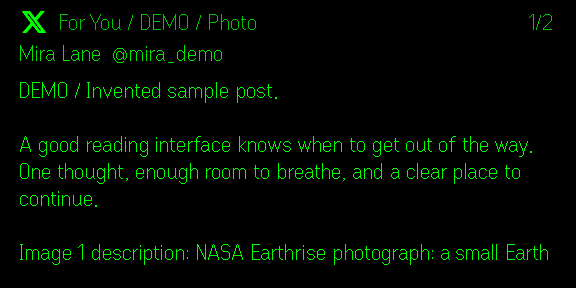
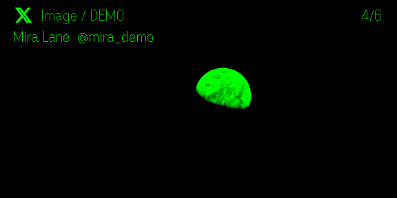

# X for G2

[](https://github.com/ihorkatkov/x-for-g2/actions/workflows/ci.yml)
[](LICENSE)

**Read X on your Even Realities G2 glasses, one post at a time.**

X is a self-hosted, unofficial reader for **For You** and **Following**. Your laptop
fetches the feed; the phone connects through a private backend and sends readable
text and still images to the glasses. X session cookies stay on the backend.

| Text first | Still-image detail |
| --- | --- |
|  |  |

*Simulator screenshots with invented posts. The demo photograph is NASA's Earthrise.*

## What it does

- **For You and Following**, with refresh, older posts and a separate reading position for each feed.
- **Full post text, reposts and quotes**, paginated using the glasses' measured font metrics.
- **Still images**, with an overview and overlapping detail pages. Reaction-only attachments open automatically.
- **Video/GIF posters**, labeled as stills. There is no video playback.
- **Skip long posts** directly with Next post / Previous post in the glasses menu.
- **Bookmark on X** saves the original post to your actual account, with a header confirmation.
- **Pinned reading**: refreshing queues new arrivals without moving the post you are reading.
- **Private device pairing** over Tailscale, plus a bounded offline reading cache in the Even host.

This app reads feeds and saves bookmarks only when you choose **Bookmark post**.
It does not post, like, publish reposts, load comment threads
or fetch arbitrary linked webpages.

**Status:** public source, self-hosted setup. A personal 0.3.1 beta was reported
working on G2. This is not a public Even Hub marketplace listing or a hosted service.

## Try the demo

Requires **Node.js 24** and npm. No X account, glasses or Tailscale is needed for the demo.

```sh
git clone https://github.com/ihorkatkov/x-for-g2.git
cd x-for-g2
npm ci
npm run build
npm run demo
```

Open **http://127.0.0.1:4040**. Use that exact hostname; `localhost` is intentionally
a different server authority. Demo mode is explicit, uses invented fixtures and
never substitutes for a failed live request.

To see the native glasses display in the desktop simulator, leave the demo server
running and open a second terminal:

```sh
npm run simulate
```

The simulator uses automation port **9902**. `npm run test:simulator` exercises
native inputs and screenshots against demo mode only. See [Development](docs/DEVELOPMENT.md)
for reproducible simulator checks and alternative ports.

## Connect your own X session

The backend uses X's web endpoints, not its supported public API. X can change or
block these endpoints. You need your own authorized session; no browser-cookie
extraction or account-login automation is included.

```sh
cp .env.example .env
chmod 600 .env
```

In your private editor, set the following in `.env`:

```dotenv
REED_MODE=live
AUTH_TOKEN=your-own-session-value
CT0=its-matching-csrf-value
```

Then run:

```sh
npm start
```

Keep these values on the backend. Do not commit them, paste them into issues, put
them in `VITE_*` variables or include them in an `.ehpk`. `.env` is ignored.
An expired or denied session produces an error; the app cannot bypass X access controls.

## Use it on glasses

You need G2 glasses paired with the Even App, **Even App 2.2.10+**, and Tailscale
connected on both the phone and the backend computer. The Tailscale CLI must be
available on the computer.

### 1. Configure your private endpoint

Add these non-secret settings alongside the server-only session values in `.env`.
Replace the example hostname and login with your own:

```dotenv
X_SERVICE_ORIGIN=https://your-laptop.your-tailnet.ts.net:8449
REED_TAILSCALE_USER=your-tailscale-login@example.com
```

`REED_TAILSCALE_USER` is your **Tailscale login**, not your X handle. The beta backend
uses port **4043** unless `REED_PORT` overrides it. The `REED_*` names are retained
for compatibility with the original beta.

### 2. Build the app and start the backend

```sh
npm run build:glasses
npm run beta:server
```

The build generates `dist-glasses/` and `app.glasses.json`, with the same HTTPS
origin in the client and network permission. There is no maintainer endpoint
fallback. The backend serves that build and binds only to loopback.

In another terminal, enable a private HTTPS proxy:

```sh
tailscale serve --bg --https=8449 http://127.0.0.1:4043
```

Keep the computer running while reading live feeds. This is **Tailscale Serve**,
not public Funnel. The backend checks the authenticated Tailscale identity and
requires an independently paired device session for every API read.

### 3. Pack and install

```sh
npm run pack
```

This creates `x.ehpk` with SDK **0.0.16** and a derived Even App floor of **2.2.10**.
For your own Even Hub app or fork, set a unique `package_id` in `app.json` **before**
building. The checked-in ID belongs to this project's existing beta.

Use your Even Hub developer account and the [official CLI](https://hub.evenrealities.com/docs/cli/index)
to upload your package, invite your tester and promote the build to beta. Install
from **Even App → Me → Beta tester**. A beta-channel build and an **Active** tester
membership are both required.

### 4. Pair this phone

```sh
npm run beta:pair
```

On macOS the one-time code appears in a local dialog; on other platforms run this
command in an interactive terminal. Enter the eight-digit code in X's phone
companion. It expires after ten minutes, works once, and locks after five wrong
attempts. Run the command again to generate a fresh code.

The phone stores a revocable device session using the SDK host storage. This is
separate from your X session: provider cookies never go to the phone. See
[Configuration](docs/CONFIGURATION.md) and [Security](SECURITY.md) for details.

## Controls

| Action | Result |
| --- | --- |
| Tap / swipe down | Next text page, then next post; load older posts at the end |
| Swipe up | Previous page or post |
| Tap then hold | System menu: refresh, switch feed, images, Next post, Previous post, Bookmark post |
| Menu → Next post / Previous post | Skip all remaining pages; enter the adjacent post at page 1 |
| Menu → Bookmark post | Add the current original post to your X bookmarks |
| Long press | Bookmark the current post; release does not turn the page |
| Double-tap in an image | Return to the same text page |
| Double-tap in text | Request the system exit dialog |
| Last/first boundary in an automatic image view | Return to the caption and descriptions before continuing |

The X mark, feed/status and page counter stay in the header. The footer has no
app chrome. Written posts stay text-first; image descriptions remain readable text.

Bookmarks use your backend X session. The header shows **Saving to X**, then
**Saved to X** only after X confirms the write. The demo shows **Demo saved** and
never contacts X. A failed or uncertain request is not automatically retried;
check your bookmarks in X if the result is uncertain. Refresh a stale cached post
before saving it. This app does not remove bookmarks or synchronize their list.

## How it works

```text
X web endpoints ← private Node backend ← Tailscale HTTPS ← phone WebView → SDK/BLE → G2
                         ↑                       ↑
                 server-only cookies     one-time paired device session
```

The glasses render native text. The phone converts photos to sixteen greys and
uploads two 268×144 PNG tiles sequentially. Three image containers including the
logo, four text containers and one event capture stay within the G2 page budget.
Text, images and host-storage calls share a serialized queue.

## Development and evidence

```sh
npm test
npm run build
# Use your real endpoint when preparing an actual glasses package:
X_SERVICE_ORIGIN=https://reader.example.ts.net:8449 npm run build:glasses
npm run pack
```

Ordinary tests use fabricated data and never read personal credentials. CI checks
a clean install, tests, both builds and packing. [Contributing](CONTRIBUTING.md)
covers code changes; [Development](docs/DEVELOPMENT.md) covers the project layout.

The original private 0.3.1 beta has **user-reported basic hardware success**.
That is not a full device certification. Phone-lock recovery, long sessions,
reconnect/exit details, all firmware combinations and physical image-transfer
latency remain to be tested. The standalone configuration changes are validated
locally and in CI; simulator results do not prove BLE or optical behavior.

## Privacy and limitations

The offline cache contains feed text in the phone host; it is bounded and validated,
not encrypted application storage. The companion has a **Clear reading cache** action.
Diagnostics contain bounded numeric/boolean measurements, not posts, authors,
cookies, pairing codes or device tokens. There is no central analytics collector.

Live operation depends on your backend, Tailscale, an authorized X session and
upstream compatibility. This repository does not provide a shared X account,
public backend, marketplace installation or multi-user hosted service.

## Credits and license

Project code is [MIT licensed](LICENSE). See [Third-party notices](THIRD_PARTY_NOTICES.md)
for Bird attribution, the NASA demo image, community references and brand assets.
This is an independent project, not an official X or Even Realities product.
